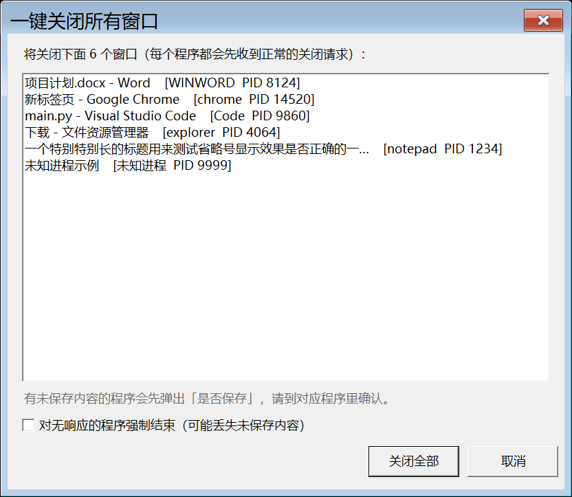

# 关窗 · close-all-windows

[中文](#中文) | [English](#english)


**一键关掉 Windows 上所有打开的窗口。** 双击图标（或按 `Ctrl + Alt + Shift + Q`），
屏幕上所有窗口在 1–2 秒内关闭，全程不弹提示、不弹 UAC。

给「同时开了一堆窗口、想立刻收摊」的人用：下班、开会、切换任务、给家人让电脑。

> 关闭方式是给每个窗口发送标准的 `WM_CLOSE`（等同于点窗口右上角的 ×），
> 所以**有未保存内容的程序仍会自己弹出「是否保存」**，不会悄悄丢数据。

---

## 中文

### 安装（3 步，不需要懂编程）

1. 到 [Releases](../../releases/latest) 下载 `guanchuang-1.0.0.zip`，解压到任意位置（桌面也行）。
2. 右键 `安装.cmd` → **以管理员身份运行**（会弹一次 UAC，点是）。
3. 看到「安装完成」就好了：桌面和开始菜单里出现「关窗」。

> 如果 Windows 提示「已保护你的电脑」，点 **更多信息 → 仍要运行**
> （原因见下方「为什么会被杀毒软件 / SmartScreen 拦」）。

### 使用

| 操作 | 效果 |
|---|---|
| 双击桌面「关窗」 | 立刻关闭所有窗口，不弹任何提示 |
| `Ctrl + Alt + Shift + Q` | 同上 |
| 开始菜单 → 右键「关窗」→ 固定到任务栏 | 之后点任务栏图标，真正“点一下就跑” |
| `CloseAllWindows.ps1 -Confirm / -DryRun / -Force` | 见下方「高级用法」 |



### 它不会关什么

- 任务栏、桌面、开始菜单、输入法、通知区域等系统窗口
- 文件夹窗口只关窗口，**不会结束 `explorer.exe`**（不会黑屏）
- 默认**不强杀**任何进程；`-Force` 才会结束无响应的程序（可能丢数据）
- 微信、Clash 这类程序关掉窗口后会缩到托盘继续运行，是它们自身行为

### 它能关掉「以管理员身份运行」的程序

安装时注册了一个名为 `OneClickCloseAll` 的计划任务：**最高权限、只在本人登录时运行、不会自动触发**。
`关窗.exe` 只是一个启动器，内部执行 `schtasks /run /tn "OneClickCloseAll"`，
所以每次都是以管理员权限静默运行，**不会再弹 UAC**。

- 计划任务被删了？启动器会提示；重新运行安装包里的 `安装.cmd`（管理员）即可修复。
- 卸载：右键 `卸载.cmd` → 以管理员身份运行。

### 高级用法

先设一个变量指向程序：

```powershell
$w = "$env:LOCALAPPDATA\OneClickCloseAll\CloseAllWindows.ps1"

# 只看看会关掉哪些窗口，不真的关
powershell -NoProfile -STA -ExecutionPolicy Bypass -File $w -DryRun

# 关之前先弹出列表确认
powershell -NoProfile -STA -ExecutionPolicy Bypass -File $w -Confirm

# 对卡死的程序强制结束（可能丢数据）
powershell -NoProfile -STA -ExecutionPolicy Bypass -File $w -Force

# 额外排除某些程序（进程名不带 .exe）
powershell -NoProfile -STA -ExecutionPolicy Bypass -File $w -Exclude chrome,msedge
```

**永久排除**：用记事本打开 `%LOCALAPPDATA%\OneClickCloseAll\CloseAllWindows.ps1`，
找到 `$UserExclude = @('DeepSeek Harness')` 一行，按注释加进程名，保存即生效
（`@()` 表示谁都不排除）。

每次运行的明细记录在 `%LOCALAPPDATA%\OneClickCloseAll\last-run.log`。

### 从源码构建

需要 .NET Framework 4（Windows 自带）：

```powershell
powershell -NoProfile -ExecutionPolicy Bypass -File .\build\build.ps1
```

产物在 `dist\`：`关窗-安装包\` 目录和 `关窗-安装包.zip`。
编译只是把 `src\Launcher.cs` 用系统自带 `csc.exe` 编成 `关窗.exe`（一个几十 KB 的启动器），
真正的逻辑在 `src\CloseAllWindows.ps1`，可以直接改、不用重编译。

想换图标：改 `build\make-icon.py` 里的颜色/尺寸，`python build\make-icon.py` 重新生成
`assets\closeall.ico` 与预览图（需要 Pillow），再跑一次 build 即可。

### 图标

`assets\closeall.ico` 是**纯代码绘制的原创图标**（暖橙渐变 + 白色窗口 + 红色关闭角标），
不含第三方素材，生成脚本就是 `build\make-icon.py`，与程序同样以 MIT 许可发布，可随意修改。

### 工作原理

```
关窗.exe  ──schtasks /run──▶  计划任务 OneClickCloseAll（最高权限、静默）
                                    │
                                    ▼
                       powershell -File CloseAllWindows.ps1
                                    │
        EnumWindows 遍历顶层窗口 → 过滤（无标题/不可见/有 owner/被 DWM 挂起/
        工具窗口/系统宿主窗口/父进程链/排除名单）→ 逐个 PostMessage(WM_CLOSE)
                                    │
                        等待窗口消失（默认 8 秒）→ 写日志
```

- 过滤掉「有 owner 的窗口」：它们是弹出对话框，会跟着主窗口一起关，重复计数没意义。
- 过滤 `explorer.exe`、`dwm.exe` 等系统进程，永不强杀。
- 每步都有保护：自己的 PID、父进程链、控制台窗口都不会被关。

### 为什么会被杀毒软件 / SmartScreen 拦

- 安装包里的 `.ps1` 和 `.exe` **没有代码签名证书**，Windows 会对来源不明的文件提示风险。
- 「关闭所有窗口」这一类行为本身容易被启发式引擎标记。
- 代码全部开源在这个仓库里，你可以逐行核对（主程序约 660 行，没有联网、没有收集数据）。

### 常见问题

| 现象 | 原因 / 处理 |
|---|---|
| 双击图标没反应，或弹「没能启动任务」 | 计划任务被删了（清理软件常见），重新运行 `安装.cmd`（管理员）即可修复 |
| 某个程序没关掉 | 它多半在问「是否保存」，或本身已卡死；`last-run.log` 会记下哪个没关 |
| 关完发现某个程序还在托盘 | 微信/Clash 等程序关窗口后缩到托盘继续跑，是它们自身行为 |
| 想先看一眼再关 | 用 `-Confirm` 参数，会列出将要关闭的窗口 |

### 卸载

右键 `卸载.cmd` → 以管理员身份运行。它会删除计划任务、快捷方式和 `%LOCALAPPDATA%\OneClickCloseAll`。
任务栏图标如果还在，右键 →「从任务栏取消固定」。

### 已知限制

- 只支持 Windows 10 / Windows 11（依赖 `DwmGetWindowAttribute`、PowerShell 5.1）。
- 最小化到托盘的窗口不算“打开的窗口”，不在列表里。
- UWP/商店应用可能被 Windows 挂起（cloaked），会被跳过。
- 提权进程（TrustedInstaller 等）的窗口无法关闭，除非程序本身响应。

### 许可

[MIT](LICENSE)

---

## English

**Close every open window on Windows with one click.**

Double-click the icon (or press `Ctrl + Alt + Shift + Q`) and all visible application windows are
closed within a second or two — no dialog, no UAC prompt. It sends a standard `WM_CLOSE` to each
window (same as clicking the ×), so apps with unsaved work still show their own save prompt.

- **Install:** download `guanchuang-1.0.0.zip` from [Releases](../../releases/latest), extract,
  right-click `安装.cmd` → *Run as administrator*.
- **Why no UAC every time:** the installer registers a scheduled task (`OneClickCloseAll`,
  highest privileges, interactive logon only, no trigger); the tiny `关窗.exe` just runs that task.
- **Safe by default:** never force-kills processes, never touches `explorer.exe`, skips taskbar /
  desktop / IME / cloaked windows. Force-kill only with `-Force`.
- **Build:** `powershell -NoProfile -ExecutionPolicy Bypass -File .\build\build.ps1`
  (uses the `csc.exe` shipped with .NET Framework).
- Windows 10/11 only. MIT licensed.

> The UI and docs are in Chinese (the tool was built for a Chinese-speaking user). Code and
> comments are in Chinese too, but the mechanics are simple: `src/CloseAllWindows.ps1` is the
> whole program.

---

## 仓库结构

```
src/        真正的程序（PowerShell + 内联 C#）
installer/  安装 / 卸载 / 修复计划任务
assets/     图标与截图
build/      一键构建安装包
docs/       给最终用户看的纯文本说明
```

## 免责声明

本工具会关闭你当前打开的所有窗口。请自行确认没有正在进行、且不会自动保存的工作。
作者不对因使用本工具造成的任何数据丢失负责。
